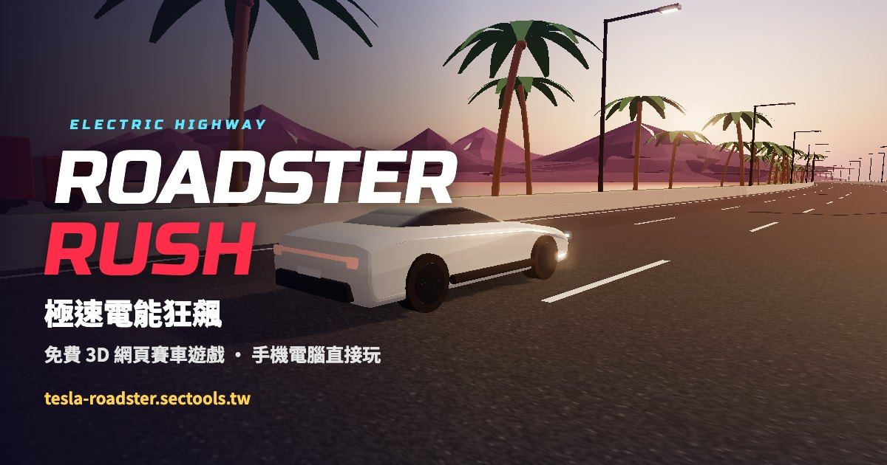

# Roadster Rush 極速電能狂飆 🏎️⚡

免費 3D 網頁賽車遊戲：駕駛白色電動超跑在夕陽海岸大橋上狂飆，閃避車流、擦身超車、飛躍跳台、空中翻滾。

**▶ 立即遊玩：<https://tesla-roadster.sectools.tw/>**　｜　📖 [完整攻略](https://tesla-roadster.sectools.tw/guide.html)

🌏 [English](https://tesla-roadster.sectools.tw/en/) ・ [日本語](https://tesla-roadster.sectools.tw/ja/)



## 玩法

| | 電腦 | 手機 |
|---|---|---|
| 轉向 / 變換車道 | ← → 或 A / D | 按住螢幕左 / 右半邊 |
| 🚀 噴射推進器（飛起來！） | ↑、W 或 J | 左下角 JET 按鈕 |
| BOOST 加速 | Space 或 Shift | 右下角 BOOST 按鈕 |
| 煞車 | ↓ 或 S | — |
| 空中翻滾 | 飛起來時按 ← → | 飛起來時按住左 / 右 |
| 暫停 / 靜音 | P / M | 右上角按鈕 |

## 得分

- **NEAR MISS / SUPER CLOSE**：高速貼近其他車輛超車
- **COMBO**：連續特技累積倍數，撞護欄會中斷
- **跳台**：滯空時間、JUMP OVER 飛越車輛、BARREL ROLL 空中翻滾
- **BOOST PAD**：藍色加速墊補充電量
- **閃過三寶**：後段出現頭頂「三寶」標誌的車（龜速占內線、突然切入、急煞、蛇行、3 km 後還有逆向車），閃過分數加倍
- **FLIGHT**：按住噴射推進器懸浮飛行（致敬 Roadster 的 SpaceX 套件），飛越車流；燃料在地面自動回充，擦身超車也會補充

首次開局會播放致敬 2026 Roadster 發表會的開場特技：衝上捲曲坡道倒立、空中翻轉落地（可點擊略過）。

10 個成就可在開始畫面查看；最佳紀錄達標可解鎖車色（烈焰紅、午夜黑、深海藍、香檳金、星際銀），遊戲結束可分享或下載成績圖。

## 技術

- 單一檔案 `index.html`，使用 [Three.js](https://threejs.org/) r160（CDN 載入）
- 程式化生成道路、場景、車輛與音效（Web Audio），無外部素材
- Sky 大氣散射、PMREM 環境反射、陰影、Bloom 光暈
- PWA：可「加入主畫面」全螢幕遊玩
- 低效能裝置自動切換流暢模式，右上角可手動切換 HD / SD

本機測試：直接用瀏覽器開啟 `index.html` 即可（需要網路載入 Three.js 與字型）。

### 多語系

`index.html`（繁中）是唯一的原始檔，`en/index.html` 與 `ja/index.html` 由腳本產生，**不要直接改**。修改遊戲後執行：

```bash
python3 build-i18n.py
```

新增或改寫介面文字時，要同步更新 `build-i18n.py` 裡的 `STRINGS` 翻譯表；找不到原文時腳本會直接報錯，避免漏翻。攻略頁 `guide.html`、`en/guide.html`、`ja/guide.html` 為各自獨立的內容頁，共用 `guide.css`。

---

非官方粉絲作品，與 Tesla, Inc. 無關。更多免費工具：[Sectools.tw](https://sectools.tw)
